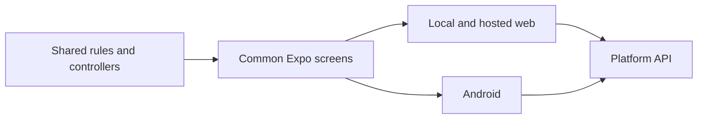

# Product Architecture

## Modules
- `mobile/src/unified/` is the only maintained screen tree for local web, hosted web and Android.
- `mobile/unified.ts` registers that tree; `mobile/index.ts` delegates to the same entry.
- `mobile/src/` also owns session transport, login, Markdown, navigation and shared primitives. Obsolete standalone native screens are removed.
- `shared/domain/` and `shared/data/` own curriculum parsing, grading and scheduling. `shared/controllers/` owns reused study controllers and account-scoped queues.
- `mobile/scripts/prepare-domain.mjs` and `prepare-unified.mjs` generate disposable Expo modules from those sources. API, date and storage contracts bind to the common authenticated runtime. Generated files are build output, never a second maintained implementation.
- `server/` and curriculum assets remain independent content tooling. Local UI uses the platform API just like hosted web; there is no separate DOM or standalone-server UI.
- Root tools and mobile dependencies retain independent lockfiles. Product code must not import sibling products.

## Example
- Input: A question text label changes in the common screen.
- Steps: Build web and Android from the product checkout.
- Expected result: Both outputs contain the same updated screen and use the existing account-bound API.
- Design: [Unified Client](../design/app/20-unified-client.md)
- Product rules: [Product Clients](../design/app/10-product-clients.md)

## Responsive Presentation

The shared Expo screens select desktop or compact composition from available logical dimensions. Browser and Android use one screen tree; session and storage adapters remain platform specific. See [Responsive Layout Design](../design/app/30-responsive-layout.md).

## Reading Materials

ReadingLibrary renders prose and vocabulary management alongside the existing study screens. ReaderText uses native word actions or inline keyboard accessible web buttons. Account session transports call the platform reading API, which uses the serialized companion account store. Japanese definitions and notes reuse curriculum SQL; English vocabulary and notes use its account library. Server segmentation supplies the same word boundaries to web and native. See [Reading Books](../design/app/40-reading-books.md).
