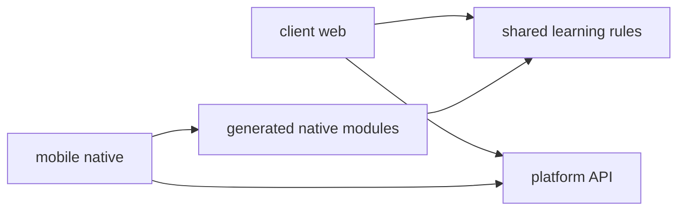

# Product Architecture

## Modules
- `client/`: Web UI and authenticated web transport. Existing domain paths re-export the shared source.
- `mobile/`: Expo and React Native UI, session storage, transport and Android tooling.
- `shared/`: Product learning rules. No browser runtime dependency is allowed in generated native modules.
- `server/` and `asset/`: Preserved local study mode and original content. Hosted account storage is owned by the platform API.
- The root npm workspace contains client and server. Mobile uses its own lockfile and dependency installation to keep React Native and React DOM dependencies isolated.

## Example
- Input: A signed-in mobile learner completes a unit.
- Steps: The native adapter uses shared rules; the transport sends the original account-bound request to the platform API.
- Expected result: The server saves only the current account records.

- [Design](../design/app/10-product-clients.md)
