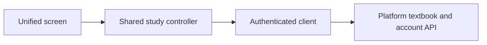

# Data Flow

The unified Expo screen combines textbook content with the current account records received through the platform client. Shared controllers handle study interactions and submit changes through the account-scoped queue.

See [Architecture Overview](10-overview.md).
