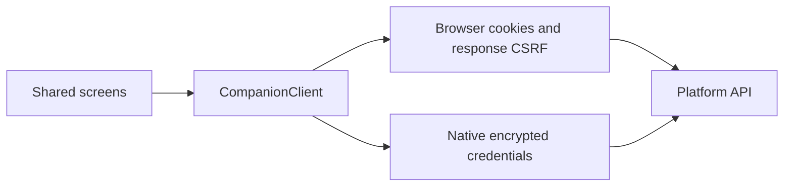

# Unified Client Design

- Spec: [Unified Client](../../specs/app/20-unified-client.md)
- Architecture: [Overview](../../architecture/10-overview.md)
- Scenarios: [Unified Client](../../testing/scenarios/app/20-unified-client.md)

## Platform Session
- Input: API origin, product key, session store and fetch implementation.
- Output: Serialized authenticated requests and current account details.
- Code: `mobile/src/client.ts` exports `CompanionClient` and `User`. Existing native callers keep the default native mode. The optional browser mode restores cookies directly through `/auth/session`, sends `credentials: include`, never constructs a Cookie header and obtains CSRF from response bodies. Native mode keeps encrypted explicit cookies and `credentials: omit`.
- `mobile/src/platformClient.ts` exports `createPlatformClient`, using Expo fetch and SecureStore under the existing Japanese key. `platformClient.web.ts` exports the same factory using browser fetch and `EXPO_PUBLIC_JPC_API_ORIGIN`.
- `account` reads complete session details and rejects an unexpected account ID. `googleConfig`, `googleChallenge` and browser-only `googleLogin` implement the existing Google exchange.
- `CompanionClient.fetch` adapts source-write controllers to this same serialized transport. It accepts only this product's API origin and companion prefix, GET or POST, preserves HTTP error status for retry handling, and checks the original `x-companion-user` against the validated session before sending writes.
- `account` reads the top-level `hasLocalPassword` session flag and combines it with the user fields for display. Error payloads remain available to backup warning handling through `ApiError.payload`.
- `onUnauthenticated` notifies the gate for every 401, including clock and account calls outside the source-write adapter. `login` accepts the selected remember flag; `mobile/src/LoginScreen.tsx` renders it for the shared entry.

## Shared Screens
- Input: Server curriculum, account preferences, calendar and authenticated account.
- Output: React Native views and original source-addressed writes on browser and Android.
- `mobile/unified.ts` registers `mobile/src/unified/App.tsx`; the app owns login, password changes, account-specific remounting, clock refresh, notices and tab navigation.
- `mobile/src/unified/useStudyModel.ts` exports `loadStudy`, `useStudyModel`, `BootData`, `Preferences` and `StudyModel`. It hydrates the selected book cache and composes the existing dashboard, learning plan, source persistence, session, grading, import and scheduling controllers. It does not maintain a second scheduling algorithm.
- `mobile/src/unified/HomeScreen.tsx` exports `HomeScreen` for daily queues, book choice, Day search, failed-only filtering, stage distribution, recent study and progress dates. Pending source writes are excluded from the daily queue. Missing decomposition opens the existing Day import workflow.
- `mobile/src/unified/SessionScreen.tsx` exports `SessionScreen`: study and quiz, original IDs, per-character readings, meaning visibility, note editing, question editing, item jumps, resizable desktop panel and phone sheets. `QuizMemo` remounts by the source-derived item key and never enters model or persistence state.
- `mobile/src/unified/WordActions.tsx` exports `WordActions`, which passes copy/import/reset operations to the maintained product helpers. Copy serializes the original word payload to JSON; imports retain existing-data protection and source positions.
- `mobile/src/unified/SettingsScreen.tsx` exports `SettingsScreen` and `Display`, covering the account card, profile link, logout, theme, device mode, daily/SRS settings, backup with mojibake confirmation, restore, local cache reset, queue controls and debug copy.
- `mobile/src/unified/ui.tsx` exports `Theme`, `palettes`, `layout`, `Label`, `Card`, `Action`, `Field`, `Sheet`, `Meter` and `Memo`. Inputs are screen values and callbacks; outputs are themed native primitives. `StudyMarkdown` reads the same theme while retaining its safe link/image rules.

## Reused Controllers
- `mobile/scripts/prepare-domain.mjs` now also runs `mobile/scripts/prepare-unified.mjs`. The latter recursively transpiles runtime dependencies of an explicit controller allowlist from `client/src/` and `shared/` into ignored generated files. Browser API, cache and account-date imports are bound to `mobile/src/unified/runtime.ts`; unexpected window, document or import.meta usage rejects generation.
- `mobile/src/unified/runtime.ts` exports the shared `client`, `listenForExpiry`, `setClock`, `getTodayString`, `apiUrl`, `apiFetch`, `hydrateState`, `loadState`, `saveState` and `clearState`. Source writes retain their original account header even after an account change. The clock projects monotonic elapsed time in the account zone.
- `mobile/src/unified/storage.ts` exports `hydrate`, `read`, `readAsync` and `write`: native AsyncStorage plus a hydrated synchronous cache; `mobile/src/unified/storage.web.ts` implements the same boundary with browser storage. State keys retain the existing account and book names.
- `mobile/src/unified/identity.ts` exports `identifyStudyState` and `displayItemId`. Session keys use the source address tuple, while display/copy retains the original ID. This preserves the old native client's support for duplicate item IDs without changing any server address.
- `client/src/domain/sourceWriteQueue.ts` exports `configureQueueStorage`, `QueueStorage`, `StoredQueueRecord` and `NewStoredQueueRecord` for native persistence injection; existing browser callers keep IndexedDB by default.
- `mobile/src/unified/queueStorage.ts` exports `NativeQueueStorage`, consuming account-scoped read/save callbacks and serializing JSON snapshots. Corrupt/read-failed storage is preserved and marked memory-only; write failure retains the live queue and reports that persistence is unavailable.

## Platform Components
- `mobile/src/unified/GoogleButton.tsx` defines `GoogleButtonProps` and the native no-button implementation; `.web.tsx` renders GIS in the native web View with nonce refresh and retry behavior.
- `mobile/src/unified/platform.ts` and `.web.ts` export `confirmAction`, using native dialogs or browser confirmation respectively. `useMainReturn` retains its existing mounted-screen and busy guards on both platforms.
- `mobile/src/unified/useSessionKeys.ts` and `.web.ts` export `useSessionKeys`: native touch/hardware controls, or the original browser number/arrow/space handlers and note shortcut outside editable fields.
- `mobile/src/unified/useNoticePreview.ts` and `.web.ts` export `useNoticePreview`, providing browser developer-preview state only on web. `mobile/src/unified/Notices.tsx` exports `loadNotices` and `Notices`, keeping independent health/notice reads, app ID 42, outage precedence, eight-second normal notices and persistent outage notices.
- `mobile/src/unified/config.ts` exports `API_ORIGIN`, `SITE_ORIGIN` and `NOTICE_APP_ID` from Expo build settings.
- `mobile/src/unified/useHomeFocus.ts` and `mobile/src/unified/useHomeFocus.web.ts` export `useHomeFocus`, refreshing home content after queued writes on native foregrounding or browser focus/visibility changes.
- `mobile/src/useMainReturn.ts` uses browser confirmation on web and retains native dialogs and stale-callback guards on Android. `mobile/src/StudyMarkdown.tsx` reads the common theme; `mobile/src/LoginScreen.tsx` accepts the shared remember control and Google button slot.
- `mobile/app.config.js` enables Metro web output. `mobile/plugins/with-short-cmake-path.cjs` configures separate application/library CMake staging before Expo evaluates projects, including Expo modules built from source.

## Hosted Packaging
- Input: `mobile/package.json` and its independent lockfile, common screens, maintained client controllers and shared source.
- Output: The Expo web export served by the existing static HTTP server.
- Code: `Dockerfile` installs only mobile dependencies, copies the controller/shared sources for preparation, maps the existing VITE build arguments to Expo public settings, and copies `mobile/dist/web` into the final image. `.dockerignore` excludes native build output and generated caches.
- `.github/workflows/ci.yml` checks both web and Android JavaScript exports in addition to the existing product tests. These exports do not establish APK or physical-device behavior.
- Example: Build the hosted image with API origin `https://api.jace-s.com` and notice ID 42; it serves the same React Native screen tree as the Android entry while the independent local study server keeps its existing local client.

## Representative Scenario
- Input: A queued write created by account A while account B is currently signed in.
- Steps: The controller passes its original account header through `CompanionClient.fetch`; the client checks the validated session ID.
- Expected result: A 403 ACCOUNT_CHANGED response is returned without any network request. Another account's results cannot be saved.
