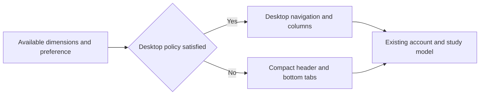

# Responsive Layout Design

- Spec: [Responsive Layout](../../specs/app/30-responsive-layout.md)
- Architecture: [Overview](../../architecture/10-overview.md)
- Scenarios: [Responsive Layout](../../testing/scenarios/app/30-responsive-layout.md)

## Layout Policy
- Input: `useWindowDimensions()` width and height in logical pixels, and existing manual device preference where supported.
- Output: Desktop or compact composition without changing the screen model or creating an Android specific screen tree.
- Code: `mobile/src/unified/responsive.ts` exports `isDesktopLayout(width, height, mode)`. Auto requires width >= 1024 and min(width, height) >= 600. Phone and PC preferences explicitly override auto. `App.tsx` reads dimensions and passes the layout to the shell, dashboard and existing study panels.
- Each product owns its copy of the small policy because product builds cannot import sibling repositories.

## Presentation
- Inputs: Active tab, navigation callbacks, current account date, existing dashboard data and theme.
- Output: Accessible selected tabs, desktop navigation and dashboard columns, compact mobile navigation, themed cards and real progress counts.
- Code: `mobile/src/unified/` modules `Chrome.tsx, ui.tsx, Dashboard.tsx, HomeScreen.tsx, SessionScreen.tsx`. `Chrome` renders navigation without owning account or study state; HomeScreen consumes the existing study model.
- The root view paints one radial sakura glow over the base color. It is sized to the viewport, not the document, so it never repeats while scrolling.

## Former Web Parts
The parts reproduce the former DOM web theme (`client/src/ui/theme.css` before 8fa4351) with the same colors, sizes and spacing, using the 16px rem base.
- `ui.tsx`: `T` (themed text), `Card` (title, hint, actions), `Btn` (default, primary gradient, ghost, danger; icon and large sizes), `Action`, `Chip` (review, learning, fail, pass, mute), `Meter` (with an optional label row; sakura or blue), `Switch`, `CopyId`, `Segment`, `Input`, `Field`, `Empty`, `Spinner`, `Sheet`, `MemoEditor`, `MarkdownBox` and `Toast`.
- `Sheet` is a bottom sheet with a grip on phones and a centered dialog of at most 680 pixels on PC; the `Device` context selects the form. Escape closes it on the web.
- `MemoEditor` shows a dashed preview; one press edits the personal memo and two presses edit the decomposition, as before.
- `Chrome.tsx`: PC top bar with the brand mark and the due count on the today tab; phone header with the tab title and a bottom tab bar with a due badge.
- `Dashboard.tsx`: `Stats` (tiles with a colored left stripe), `StageChart`, `RecentDays`, `DayGrid` (tiles with a pass-ratio fill), `ProgressPanel`, `DayCard` (blue review or green learning tint), `ActionTile` and `WordActionCard` (copy and input actions with progress and done states).
- `SessionScreen.tsx`: top bar (back, title with position, phase switch, list, note and hide segment or phone icons, word data), centered word card with readings above the characters, quiz sentence card, numbered choices, PASS or FAIL verdict, item tile grid, problem editor sheet and bottom previous and next buttons.
- `LoginScreen.tsx`: a centered 360 pixel card with Google sign-in, fields, the remember check, a primary submit and the main page link.
- Gradients use `backgroundImage` on the web and `experimental_backgroundImage` on Android; where a platform ignores them, the solid base color remains.

## Representative Scenario
- Input: Home at 1280 by 800, followed by 915 by 412.
- Steps: Read dimensions, evaluate the policy, reflow the existing components.
- Expected result: Desktop navigation and columns become compact tabs and stacked cards without resetting application state.

## Supporting Screens

- `mobile/src/ui.tsx` keeps the loading indicator. `mobile/src/unified/SettingsScreen.tsx` uses the main content width with former settings rows, segments and a collapsible debug log.
- Day and chapter listings use wrapped desktop card grids and compact stacked cards. Existing session panels receive the same dimension policy and theme without a separate screen implementation.

## Mobile Book Selection
- Input: `model.books`, `model.book` and the existing `switchBook` callback in `mobile/src/unified/HomeScreen.tsx`.
- Output: Mobile-only full-width book selection above today, Day and progress content. Desktop retains the existing Segment and its multiple-book visibility rule.
- Code: `mobile/src/unified/BookSelect.tsx` exports `BookSelect`. Web renders a native labelled select with 44 pixel minimum height; Android uses the existing themed Sheet with radio options. Empty lists disable selection. Home disables the control while switching and reports existing model errors through notify.
- Scenario: With two books at 390 pixels, choose the second book. Steps: Select its option, invoke switchBook and load its existing account-scoped state. Expected result: The selected book changes without modifying source addresses or saved progress; PC retains its previous controls.
- All scenarios: [Mobile Book Dropdown](../../testing/scenarios/app/30-responsive-layout.md#mobile-book-dropdown).
