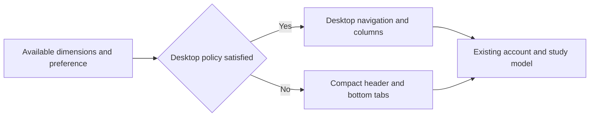

# Responsive Layout Design

- Spec: [Responsive Layout](../../specs/app/30-responsive-layout.md)
- Architecture: [Overview](../../architecture/10-overview.md)
- Scenarios: [Responsive Layout](../../testing/scenarios/app/30-responsive-layout.md)

## Layout Policy
- Input: `useWindowDimensions()` width and height in logical pixels, and existing manual device preference where supported.
- Output: Desktop or compact composition without changing the screen model or creating an Android specific screen tree.
- Code: `mobile/src/unified/responsive.ts` exports `isDesktopLayout(width, height, mode)`. Auto requires width >= 1024 and min(width, height) >= 600. Phone and PC preferences explicitly override auto. `App.tsx` reads dimensions and passes the layout to the shell, dashboard and existing study panels.
- Each product owns its copy of the small policy because product builds cannot import sibling repositories.

## Presentation
- Inputs: Active tab, navigation callbacks, current account date, existing dashboard data and theme.
- Output: Accessible selected tabs, desktop navigation and dashboard columns, compact mobile navigation, themed cards and real progress counts.
- Code: `mobile/src/unified/` modules `Chrome.tsx, ui.tsx, HomeScreen.tsx`. `Chrome` renders navigation without owning account or study state; HomeScreen consumes the existing study model. Theme primitives style existing settings, study and quiz screens too.
- Japanese `Dashboard.tsx` exports `Stats` and `StageChart`, consuming labeled totals and stage counts and rendering responsive cards and a vertical stage distribution. These are product specific presentation modules.
- All backgrounds are opaque native colors; no document-sized repeated background image is used.

## Representative Scenario
- Input: Home at 1280 by 800, followed by 915 by 412.
- Steps: Read dimensions, evaluate the policy, reflow the existing components.
- Expected result: Desktop navigation and columns become compact tabs and stacked cards without resetting application state.

## Supporting Screens

- `mobile/src/ui.tsx` uses the restored dark palette for login and loading screens, with a centered bounded form. `mobile/src/unified/SettingsScreen.tsx` bounds account and preference cards to 900 logical pixels.
- Day and chapter listings use wrapped desktop card grids and compact stacked cards. Existing session panels receive the same dimension policy and theme without a separate screen implementation.
