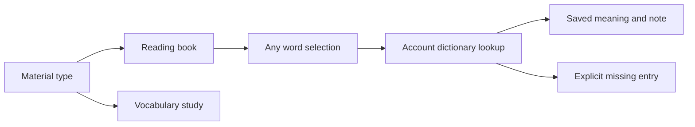

# Reading Books Design

- Spec: [Requirements](../../specs/app/40-reading-books.md)
- Architecture: [Overview](../../architecture/10-overview.md)
- Scenarios: [Cases](../../testing/scenarios/app/40-reading-books.md)

## Storage And Lookup
- Input: Account identity, product, material type, title, prose, vocabulary and selected word.
- Output: Account-owned materials and at most one lookup result and personal note.
- Code: Platform services/api/src/services/companions/readingLibrary.ts and companion routes; product ReadingLibrary.tsx and readingWords.ts. English uses its serialized EnglishClient; Japanese uses the existing runtime apiFetch adapter.
- Reuse the account JSON store for materials and English notes. Japanese lookup reuses its curriculum and SQL personal notes. Same spelling in several materials resolves deterministically without deleting curriculum or progress.
- Use word segmentation for every prose word. Whitespace and punctuation retain their original positions. The server supplies word boundaries to native engines without Intl Segmenter.
- Existing Japanese personal-vocabulary management remains available alongside reading-book management. English personal vocabulary joins the existing study session and progress flow.

## Representative Scenario
- Input: A learner opens a story and selects an unknown word.
- Steps: Segment prose, activate the selected word, query the current account dictionary.
- Output: A visible missing-entry message without guessing a translation or showing another word note.

## Public Components And Transport
- ReadingLibrary lists books and opens prose; MaterialEditor validates the chosen material type; WordLookup handles loading, missing entry, retryable errors and saving notes. ReaderText renders accessible word actions, preserving punctuation and line breaks. readingWords exports LibraryBook, LibraryWord, WordDetail, LibraryApi, ProseWord and segmentProse.
- Server readReadingLibrary returns account materials and server-generated tokens; saveReadingBook validates ownership and preserves stable word IDs; lookupReadingWord returns one matching study entry or null; saveReadingNote updates the unique account note; readingWordKey normalizes identity. ReadingLibraryError carries expected validation status.
- Japanese readingApi reuses apiFetch. EnglishClient.libraryRequest snapshots the account when queued and validates it again before sending, then uses existing serialized CSRF transport.
- Japanese PersonalBooks selects book or vocabulary; prose uses MaterialEditor and vocabulary retains existing createPersonalBook and import. English HomeScreen includes account vocabulary in study queues, and SessionScreen opens saved notes from study cards without exposing quiz answers early.
- Server segmentation is authoritative for saved prose. segmentProse is only a preview fallback, with Unicode script-run fallback on older runtimes. No dictionary-only click restriction exists.

## Creation And Examples
- The editor uses title and body inputs for books, and word, meaning and example rows for English vocabulary. JSON is only the transport representation.
- Japanese original example 雨の日の手紙 includes 素直 from the maintained vocabulary, while unknown words remain selectable. English original example The Open Window ships with a small matching example vocabulary material.
- Japanese existing SQL notes already have a user and expression primary key. The local duplicate audit found zero duplicate groups, so no note deletion or backup was necessary. English note keys normalize case and width and every write upserts one value.
