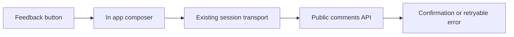

# Feedback Dialog Design

- Input: Feedback button activation, draft text, current session, optional guest password and motion preference.
- Output: An in app composer, a public comment confirmation or a retryable error.
- Code: mobile/src/unified/FeedbackSheet.tsx, mobile/src/unified/SettingsScreen.tsx, mobile/src/unified/ui.tsx, mobile/src/client.ts.

Signed in settings reuse the existing Sheet: slide on phones and fade on desktop. submitFeedback captures the account identity and uses the serialized credential transport with sourceAppId 5.

- Spec: [Feedback Dialogs](../../specs/app/98-feedback-dialogs.md)
- Architecture: [Overview](../../architecture/10-overview.md)
- Scenarios: [Feedback Dialogs](../../testing/scenarios/app/98-feedback-dialogs.md)

## Example

- Input: A visitor opens Feedback with reduced motion disabled.
- Steps: Display the animated composer, enter a draft, receive a failed API response and retry explicitly.
- Expected result: The draft remains available for retry and clears only on success.

