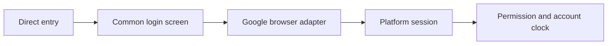
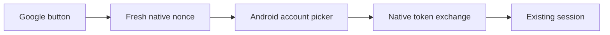

# Google Sign In Design

## Transport
- Input: Google configuration, fresh nonce, credential and remember selection.
- Output: Existing platform user and browser session with response CSRF.
- Code: `mobile/src/client.ts` exposes `CompanionClient.googleConfig`, `googleChallenge` and browser-only `googleLogin`; `mobile/src/platformClient.web.ts` supplies credentialed browser fetch.
- Credential exchange includes the browser time zone. Serialized requests retain account isolation and response CSRF.

## Browser Component
- `mobile/src/unified/GoogleButton.web.tsx` loads official GIS, requests a fresh nonce, renders the button and suppresses stale/duplicate callbacks. Native `GoogleButton.tsx` provides the platform boundary.
- `mobile/src/unified/App.tsx` and `mobile/src/LoginScreen.tsx` share the login state and run app permission/bootstrap after login. Main-site entry policy remains in the platform repository.

## Example
- Input: A permitted Google-only account with no active session.
- Steps: Obtain nonce, exchange credential and load app access plus account clock.
- Expected result: The same URL opens account curriculum using response CSRF for later writes.
- Spec: [Google Sign In](../../specs/auth/50-google-sign-in.md)
- Architecture: [Overview](../../architecture/10-overview.md)
- Scenarios: [Google Sign In](../../testing/scenarios/auth/50-google-sign-in.md)

## Native Google Implementation

- Inputs: Runtime web Client ID, remember selection, server native nonce and official picker credential.
- Outputs: Existing account session or null on cancellation and stale callbacks; safe localized errors on failure.
- Code: `mobile/src/unified/GoogleButton.tsx`, `mobile/src/unified/nativeGoogleFlow.ts`, `mobile/src/client.ts` and the locked package dependencies. Android SDK autolinking is used; web resolves GoogleButton.web.tsx without loading the native SDK.
- Public contracts: NativeGoogleClient supplies config, nativeGoogleChallenge and nativeGoogleLogin; NativeGoogleProvider supplies Play Services checks, configuration and explicit account selection. signInWithNativeGoogle checks liveness between asynchronous steps, configures the fresh nonce with autoSelectOnSignIn false, and exchanges successful credentials only. GoogleButton disables duplicate submissions and ignores unmounted results.
- The client obtains POST /auth/google/native/challenge, then sends credential, nonce, remember and local timeZone to POST /auth/google/native. Existing native transport persists session and CSRF cookies in encrypted storage. Browser cookie challenges are unchanged.
- Representative scenario input: Picker cancellation followed by retry. Steps: Cancel once and open again. Expected result: No first exchange and a new nonce for the second attempt.
- Spec: [Companion requirements](../../specs/auth/50-google-sign-in.md#android-google-account-picker)
- Architecture: [Overview](../../architecture/10-overview.md)
- Scenarios: [Authentication cases](../../testing/scenarios/auth/50-google-sign-in.md#native-google-contracts)

