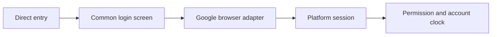

# Google Sign In Design

## Transport
- Input: Google configuration, fresh nonce, credential and remember selection.
- Output: Existing platform user and browser session with response CSRF.
- Code: `mobile/src/client.ts` exposes `CompanionClient.googleConfig`, `googleChallenge` and browser-only `googleLogin`; `mobile/src/platformClient.web.ts` supplies credentialed browser fetch.
- Credential exchange includes the browser time zone. Serialized requests retain account isolation and response CSRF.

## Browser Component
- `mobile/src/unified/GoogleButton.web.tsx` loads official GIS, requests a fresh nonce, renders the button and suppresses stale/duplicate callbacks. Native `GoogleButton.tsx` provides the platform boundary.
- `mobile/src/unified/App.tsx` and `mobile/src/LoginScreen.tsx` share the login state and run app permission/bootstrap after login. Main-site entry policy remains in the platform repository.

## Example
- Input: A permitted Google-only account with no active session.
- Steps: Obtain nonce, exchange credential and load app access plus account clock.
- Expected result: The same URL opens account curriculum using response CSRF for later writes.
- Spec: [Google Sign In](../../specs/auth/50-google-sign-in.md)
- Architecture: [Overview](../../architecture/10-overview.md)
- Scenarios: [Google Sign In](../../testing/scenarios/auth/50-google-sign-in.md)
