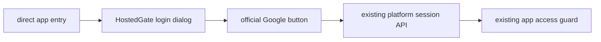

# Google Sign In Design

## Transport
- Input: API URL resolver, CSRF cache callback, fetch transport, credential and remember preference.
- Output: Runtime Google configuration, a fresh one-use nonce, or the existing HostedLoginResult.
- Code: `client/src/googleAuth.ts` exports `createHostedGoogleAuth` and `GoogleConfiguration`; `client/src/hosted.ts` exposes `hostedGoogleAuth` using its existing API resolver and CSRF cache.
- Config and nonce requests use credentials include and no-store. Credential exchange posts credential, remember and browser IANA time zone; success caches csrfToken before returning the user. Error codes are mapped to fixed UI guidance rather than displaying provider errors or tokens.

## Browser Component
- Input: remember, disabled, onBusyChange and the existing onLoggedIn callback.
- Output: Google's official Korean sign-in button, safe retry or busy text, and an existing HostedGate resolution.
- Code: `client/src/components/GoogleSignIn.tsx` exports `GoogleSignIn`. It loads the official GIS script only for an enabled config, binds a fresh nonce, and calls hostedGoogleAuth.login from the credential callback. Its mounted and busy guards ignore stale or duplicate callbacks.
- `client/src/components/HostedGate.tsx` places the button inside its existing LoginDialog. Both login methods share submitting state. The component never changes the URL or bypasses fetchHostedAppAccess and storage scope selection.
- Platform launch UI remains owned by the platform repository and is not changed by this product integration.

## Example
- Input: A Google-only account with no local password and permission to this product.
- Steps: Exchange the nonce-bound ID token, cache CSRF, then resolve the account with the existing access guard.
- Expected result: The login dialog closes and the same app URL shows the existing account curriculum.
- Spec: [Google Sign In](../../specs/auth/50-google-sign-in.md).
- Architecture: [Product Architecture](../../architecture/10-overview.md).
- Scenarios: [Google Sign In](../../testing/scenarios/auth/50-google-sign-in.md).
