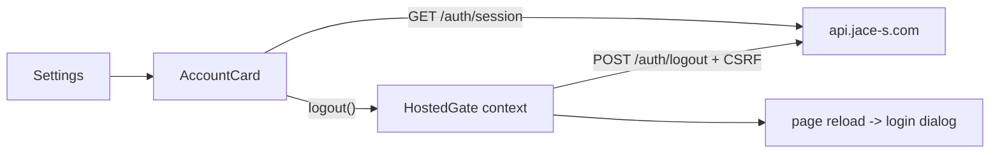

# Account Card Design

## Account Card Component
- Input: Optional `language` (`ko` or `en`), the hosted session controls from `HostedGate`, and the current session read from the API.
- Output: An account card with session details, a My Page link and a sign-out button, or nothing outside hosted mode.
- Code: `client/src/components/AccountCard.tsx` exports `AccountCard` and `AccountLanguage`; `client/src/components/SettingsView.tsx` renders it first.
- It calls `fetchHostedAccount` on mount. `hasLocalPassword === false` shows the Google-only sign-in method. Times use the browser locale.

## Session Controls
- Input: None. `HostedGate` provides `HostedSessionControls` through a React context only in the ready state.
- Output: `useHostedSession()` returns `{ logout }` inside a signed-in hosted app, otherwise null.
- Code: `client/src/components/HostedGate.tsx` exports `useHostedSession` and `HostedSessionControls`; `client/src/hosted.ts` exports `fetchHostedAccount`, `HostedAccount` and `logoutFromHost`.
- `logoutFromHost` posts `/auth/logout` to the API origin with credentials and the cached CSRF header. 2xx or 401 counts as signed out; any other status throws. `logout` then reloads the page.
- `fetchHostedSession` now delegates to `fetchHostedAccount`, keeping its previous result.

## Example
- Input: The session response has `hasLocalPassword: false` and an email with `emailVerified: true`.
- Steps: AccountCard renders the rows, the user presses sign out, the API answers 204.
- Expected result: The card listed "Google 전용" and the verified email, and the page reloads into the login dialog.
- Spec: [Account Card](../../specs/auth/60-account-card.md#account-details)
- Architecture: [Product Architecture](../../architecture/10-overview.md)
- Scenarios: [Account Card Scenarios](../../testing/scenarios/auth/60-account-card.md#account-card-scenarios)
