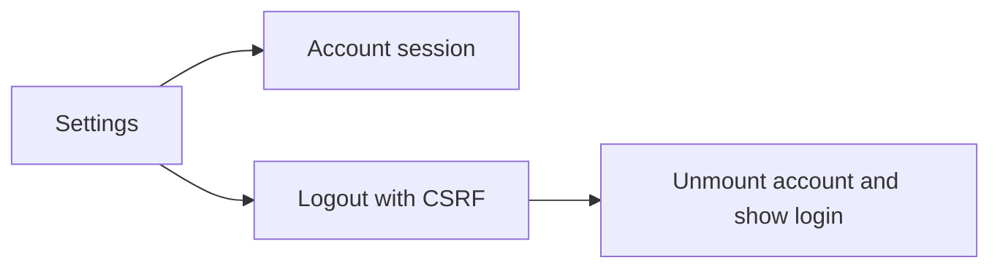

# Account Card Design

## Account Card Component
- Input: Signed-in account details and the common logout callback.
- Output: Account rows, main-site profile link and sign-out control in settings on both platforms.
- Code: `mobile/src/unified/SettingsScreen.tsx` calls `CompanionClient.account`; `mobile/src/unified/App.tsx` owns session state and account-specific remounts.
- `hasLocalPassword` distinguishes Google-only accounts. Profile changes stay on the main site.

## Session Controls
- Input: The sign-out action from settings.
- Output: A revoked session followed by the login screen, or a retryable error without leaving the account screen.
- `CompanionClient.logout` posts to the API origin with CSRF and clears credentials only after success. App resets the storage scope and unmounts the account screen after completion. No page reload is required.

## Example
- Input: A Google-only account presses sign out; the API responds 204.
- Steps: Revoke the session, clear account scope and replace the account screen with login.
- Expected result: Account details are no longer mounted and the browser session is signed out across apps.
- Spec: [Account Card](../../specs/auth/60-account-card.md#account-details)
- Architecture: [Overview](../../architecture/10-overview.md)
- Scenarios: [Account Card Scenarios](../../testing/scenarios/auth/60-account-card.md#account-card-scenarios)
